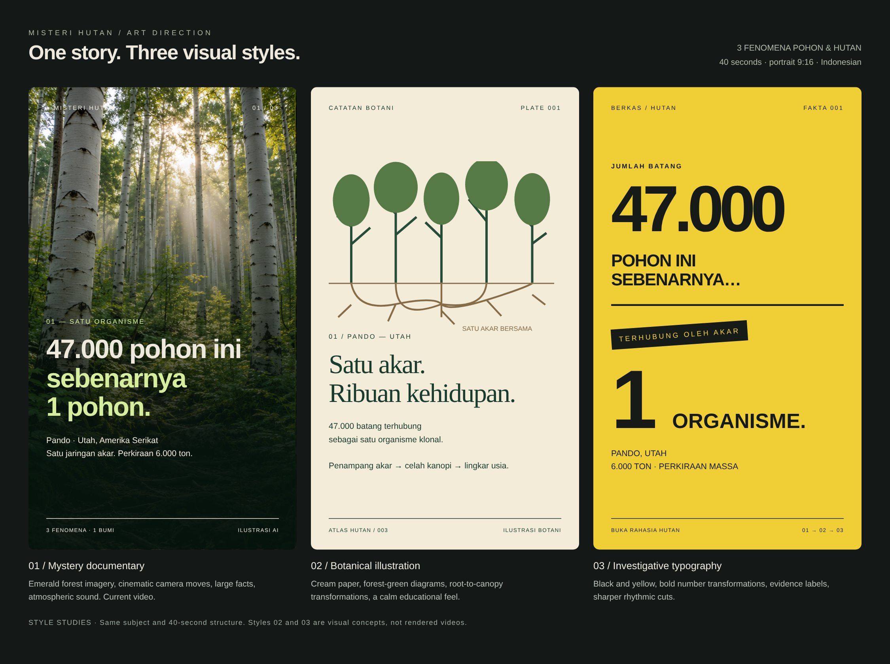

# Three visual styles

1. **Mystery documentary** — forest imagery, cinematic camera moves, atmospheric sound. The current 40-second video uses this style.
2. **Botanical illustration** — cream paper, green diagrams, root-to-canopy transformations.
3. **Investigative typography** — black and yellow, bold numbers, evidence labels.

Styles 2 and 3 are visual concept previews, not completed video renders.
